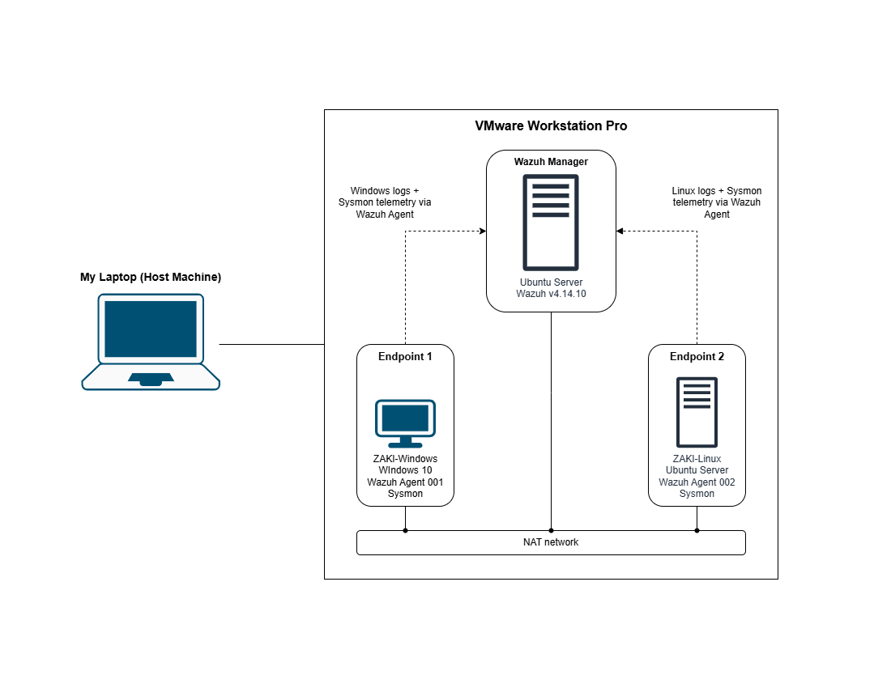

# 🛡️ Wazuh SOC Home Lab

## 📌Introduction
I built this SIEM lab environment to practice and familiarize myself with a SOC work environment reading system logs and sysmon telemetry generated by Windows and Linux endpoints.

Also included is my own built 3-panel SOC Dashboard detailing Failed Windows Logons, Linux Failed SSH Authentication Activity and Windows Accounts Changes.  

## 🏛 Lab Architecture

- **Hypervisor:** VMware Workstation Pro
- **SIEM / XDR Server:** Ubuntu Server VM running Wazuh (Manager, Indexer, and Dashboard)
- **Monitored Endpoints:** Windows and Linux virtual machines enrolled with Wazuh agents and Sysmon/host telemetry
  

## Wazuh Endpoints & Dashboard 

## 📊 Generating & Reading Telemetry

- **Telemetry Sources:** Windows Security Events, Linux SSH, and File Integrity Monitoring (FIM).

## Custom Detection Rule

## Active Response

### Skills Learned

- Advanced understanding of SIEM concepts and practical application.
- Proficiency in analyzing and interpreting network logs.
- Ability to generate and recognize attack signatures and patterns.
- Enhanced knowledge of network protocols and security vulnerabilities.
- Development of critical thinking and problem-solving skills in cybersecurity.

