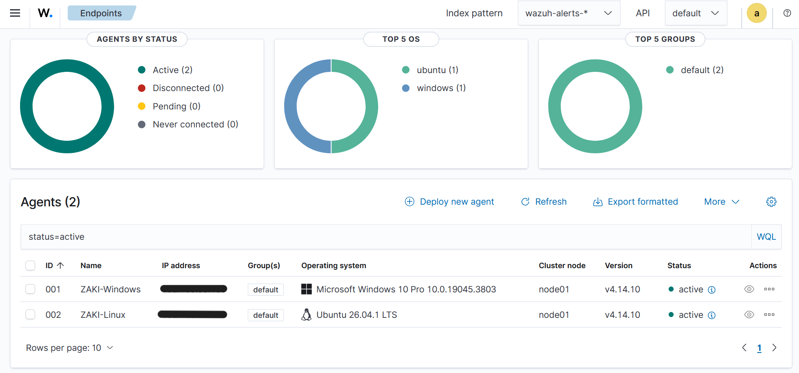
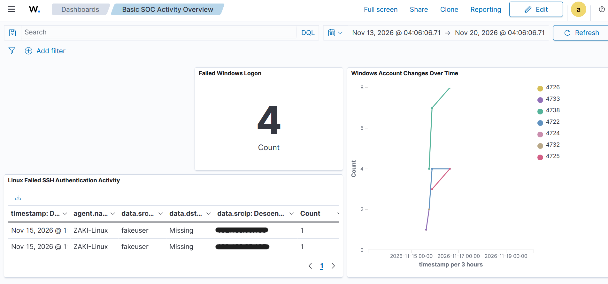
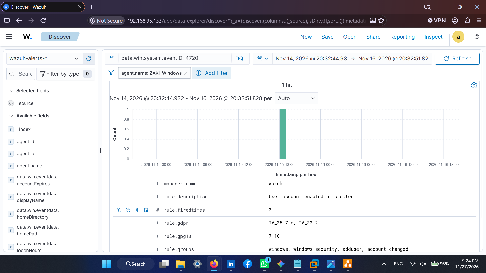
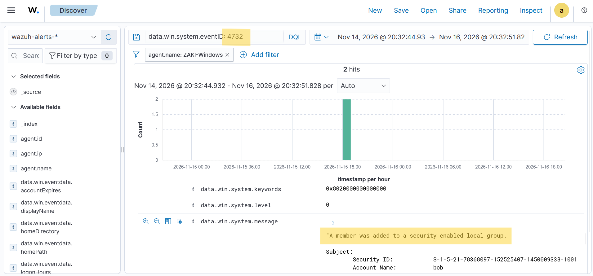
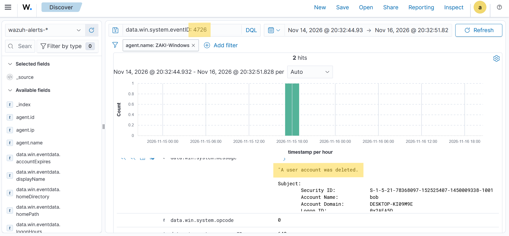
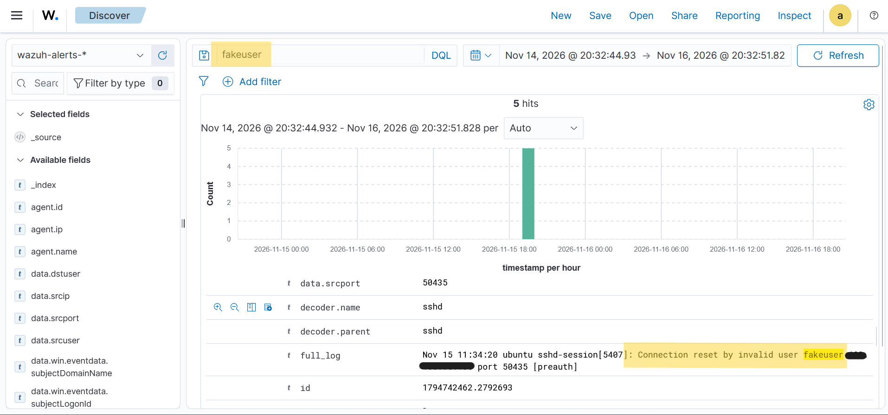
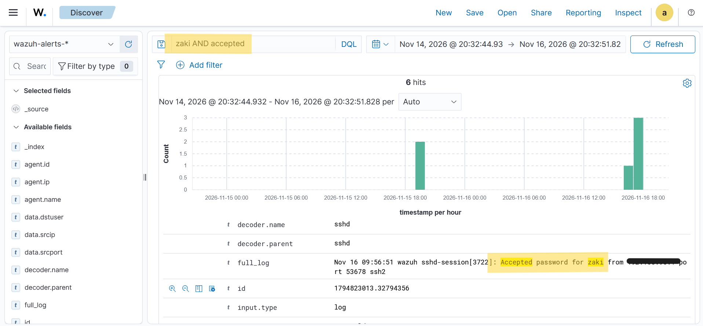
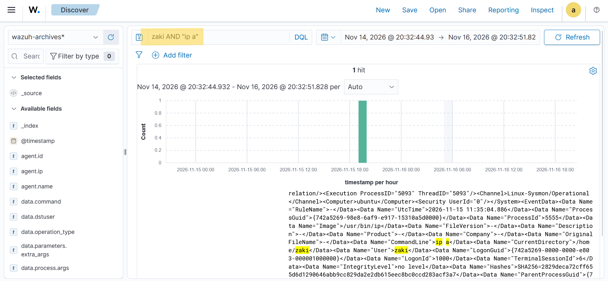
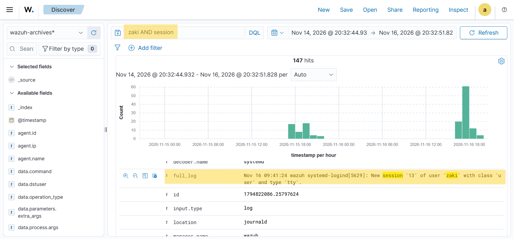

# 🛡️ Wazuh SOC Home Lab

## 📌Introduction
I built this basic SIEM lab environment to practice and familiarize myself with a SOC work environment reading system logs and sysmon telemetry generated by Windows and Linux endpoints.

Also included is my own built 3-panel SOC Dashboard detailing Failed Windows Logons, Linux Failed SSH Authentication Activity and Windows Accounts Changes.  

**will further expand to include configuring file integrity monitoring (FIM) and creating a custom detection rule.*

## 🏛 Lab Architecture
- **Hypervisor:** VMware Workstation Pro
- **SIEM / XDR Server:** Ubuntu Server VM running Wazuh (Manager, Indexer, and Dashboard)
- **Monitored Endpoints:** Windows and Linux virtual machines enrolled with Wazuh agents and Sysmon/host telemetry
  

*Ref 1: Network Diagram*

## 📊 Wazuh Endpoints & Dashboard 

 My active Windows and Linux endpoints:
  - ZAKI-Windows - Agent 001
  - ZAKI-Linux - Agent 002

*Ref 2: Endpoints*

 My centralized SOC dashboard containing:
  - Failed Windows Logon – Metric visualization
  - Windows Account Changes Over Time – Line visualization
  - Linux Failed SSH Authentication Activity – Data table

*Ref 3: Dashboard*

## 🔎 Generating & Reading Telemetry
**1. Windows Security Events**
- Generated Windows account management events from the Windows 10 endpoint by creating, modifying, and deleting a local user account.
- Security events investigated included:
  - Event ID 4720 – User account enabled or created
  - Event ID 4732 – Member added to a security-enabled local group
  - Event ID 4726 – User account deleted
- Verified the corresponding telemetry in the Wazuh Dashboard and correlated the Windows Event IDs with their security significance.

*Ref 4: Event ID 4720*

*Ref 5: Event ID 4732*

*Ref 6: Event ID 4726*

**2. Linux SSH**
- Generated SSH authentication activity between the Windows 10 endpoint and Ubuntu server.
- Activities included:
  - Failed SSH authentication using the fakeuser account.
  - Successful SSH authentication using the zaki account.
  - Executed commands within the authenticated SSH session.
  - Investigated SSH session tracking and session identifiers.
- Searched Wazuh for:
  - fakeuser
  - zaki AND accepted
  - zaki AND "ip a"
- Verified the corresponding authentication and session activity in Wazuh.

*Ref 7: fakeuser*

*Ref 8: zaki AND accepted*

*Ref 9: zaki AND "ip-a"*

*Ref 10: zaki AND session*

---

### Skills Learned

- Advanced understanding of SIEM concepts and practical application.
- Ability to generate and read telemetry from multi-OS endpoints.
- Windows Event ID analysis
- Linux SSH authentication monitoring
- Endpoint security monitoring

